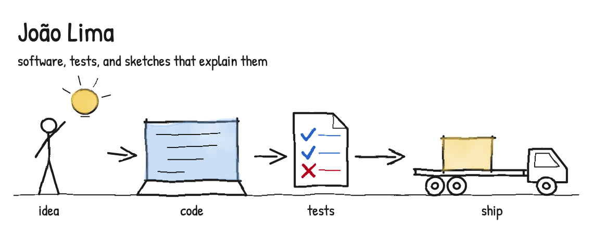
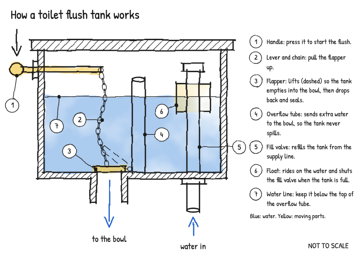
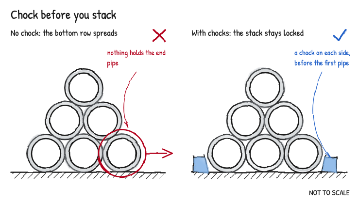
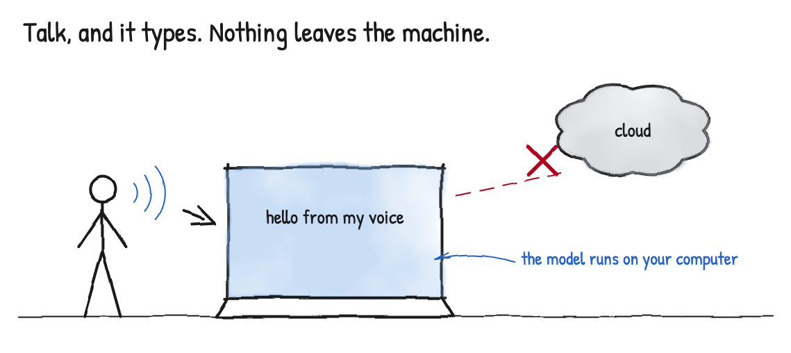
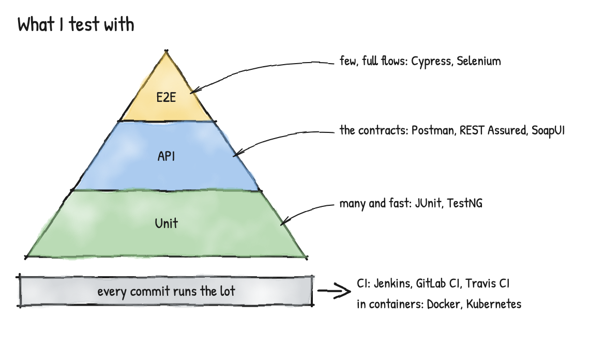

Software developer from Brazil. I write software, test it, and lately draw it.

## [Esquadro](https://github.com/LimaJoota/esquadro)

A skill for Claude Code that draws hand-style sketches to explain things, in pencil, pen and watercolour, and checks them for overlapping text before you see them. It also makes technical sheets with real scale and dimensions computed from the geometry.

This came from one prompt, in one run: *"Draw a sketch that explains how a toilet flush tank works."*

| |
|---|
|  |

## [Handy, my fork](https://github.com/LimaJoota/Handy)

My daily dictation tool: [Handy](https://github.com/cjpais/Handy) is open-source, offline speech-to-text. My macOS build adds accent colours, word replacements, paste recovery and recent transcripts in the tray.

## What I work with

- **Zello Tecnologia:** test pipelines with Cypress, Selenium and JUnit, wired into CI, plus exploratory and regression testing.
- **Edex Atacadista (internship):** Flutter, real-time notifications and theming in the company's mobile app.

## Contact

[LinkedIn](https://www.linkedin.com/in/jaolima) · [Instagram](https://instagram.com/jaolimadev)

The drawings on this page were made with Esquadro.
