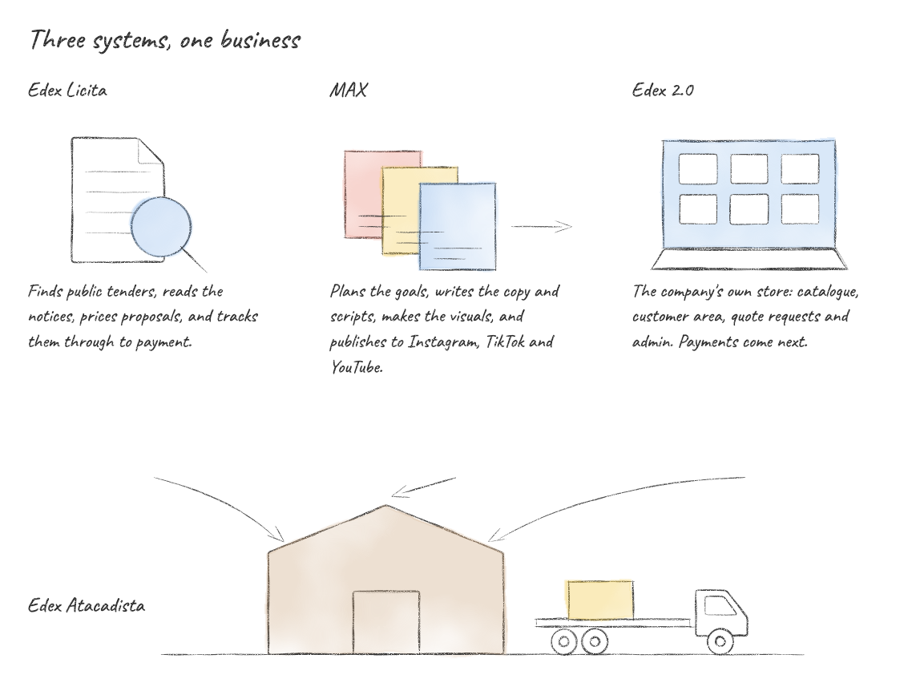

I build the software a Brazilian wholesale business runs on: winning public tenders, selling, and marketing, end to end and in production on infrastructure I run myself.

[Edex Atacadista](https://www.edexatacadista.com.br) · [LinkedIn](https://www.linkedin.com/in/jaolima) · [Instagram](https://instagram.com/jaolimadev)

## Edex

| Project | What it does | Stack |
|---|---|---|
| **Edex Licita** | Public tender platform. Watches Brazil's national procurement portal (PNCP) every hour, reads the notices with OCR and page citations, scores what is worth pursuing, prices proposals with cost kept apart from price, and tracks deadlines, documents and results through to payment. | FastAPI, PostgreSQL, React, Tailwind |
| **MAX** | Multi-tenant marketing automation with generative AI. Plans goals, writes copy and video scripts, composes visuals, checks quality, and publishes on schedule to Instagram, TikTok and YouTube. | FastAPI, PostgreSQL |
| **Edex 2.0** | The company's own sales platform, replacing its Wix site. Catalogue, customer area, quote requests and admin panel work; online payment, freight and invoicing come next. | Next.js, TypeScript, Tailwind, PostgreSQL, Prisma |
| **Loja Edex** | Edex Studios' first Roblox game: a work simulator set in a building materials warehouse. | Luau, Rojo |

The code is private. Happy to walk through it in a call.

## Other projects

- **Lapso:** multi-tenant SaaS for bars and restaurants, with floor service, kitchen display, reservations, delivery and recurring billing.
- **[Handy, my fork](https://github.com/LimaJoota/Handy):** the offline speech-to-text app I dictate with every day, plus accent colours, word replacements, paste recovery and recent transcripts in the tray.
- **Helena:** a voice secretary that places calls from my iPhone. Internal tests only.
- **Closet Wars:** a Roblox social tycoon and heist game.

## Before

Test automation and CI pipelines at Zello Tecnologia, and Flutter on Edex's mobile app.
