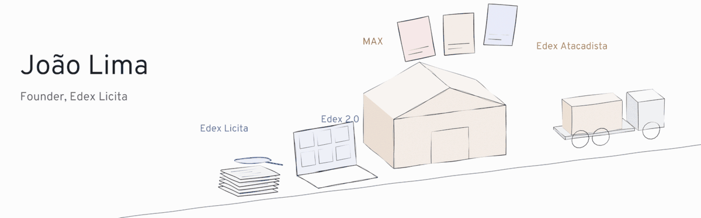

<picture>
  <source media="(prefers-color-scheme: dark)" srcset="assets/hero-dark.gif">
  <source media="(prefers-color-scheme: light)" srcset="assets/hero-light.gif">
  
</picture>

**Founder of Edex Licita**, the AI platform for Brazilian public procurement. I'm building the operating system for how a Brazilian company wins government contracts, gets found, and sells.

[LinkedIn](https://www.linkedin.com/in/jaolima) · [Edex](https://www.edexatacadista.com.br)

<table>
  <tr>
    <td><b>Edex Licita</b> · live</td>
    <td>Monitors the national procurement portal around the clock, reads the notices with AI, scores each opportunity, prices the proposal, and follows every contract through to payment.</td>
  </tr>
  <tr>
    <td><b>MAX</b> · live</td>
    <td>Autonomous marketing engine for multiple brands. Plans campaigns, writes copy and video scripts, creates visuals, checks its own quality, and publishes to Instagram, TikTok and YouTube.</td>
  </tr>
  <tr>
    <td><b>Edex 2.0</b> · launching</td>
    <td>Our own B2B commerce platform: catalogue, customer area, quote requests and admin.</td>
  </tr>
  <tr>
    <td><b>Edex Studios</b></td>
    <td>Games. First title: a Roblox work simulator set in a building materials warehouse.</td>
  </tr>
</table>

Also building **Lapso**, SaaS for bars and restaurants, and **Helena**, a voice agent that places phone calls for me. I made **[Escrevoz](https://github.com/LimaJoota/escrevoz)**, free offline voice dictation for Mac, built on [Handy](https://github.com/cjpais/Handy). My fixes go back to Handy too. **[Ouvecena](https://github.com/LimaJoota/ouvecena)** turns a screen recording into a Portuguese transcript with timestamps and one frame per line, so an AI can follow what you point at. Both run offline on a Mac, for free. I also open-sourced **[Esquadro](https://github.com/LimaJoota/esquadro)**, a Claude Code skill that draws hand-style sketches and checked technical figures, and **[Espelho](https://github.com/LimaJoota/espelho)**, which drives a real iPhone through iPhone Mirroring.

Founders, operators and investors: [let's talk](https://www.linkedin.com/in/jaolima).
